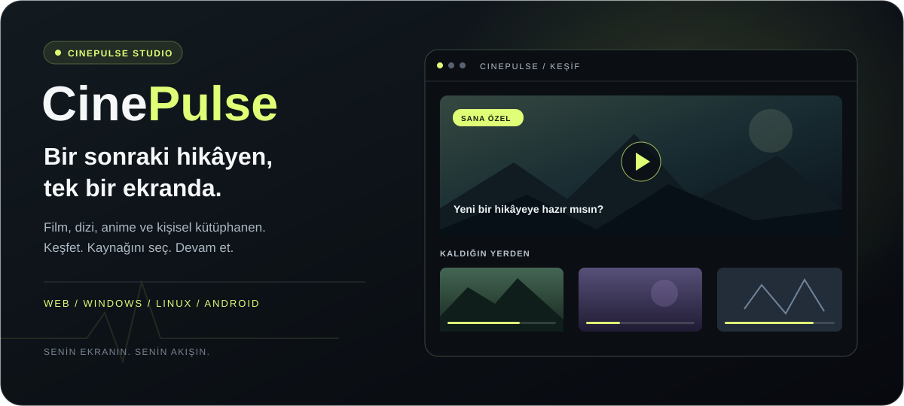

<div align="center">

<a href="https://cinepulse.cinepulse.workers.dev/">
  
</a>

### Keşfet. Listene ekle. Kaldığın yerden devam et.

Film, dizi ve anime keşfi; kişisel kütüphane, çok platformlu oynatma ve tam veri taşınabilirliği.

**Web · Windows · Linux (DEB / Flatpak) · Android**

[](https://cinepulse.cinepulse.workers.dev/)
[](https://github.com/caca1403/cine-pulse/releases/latest)
[](https://github.com/caca1403/cine-pulse/actions)
[](https://github.com/caca1403/cine-pulse/actions)

[Özellikler](#1-nedir) · [İndir](#3-platformunu-seç-ve-indir) · [Kurulum](#4-kurulum-adım-adım) · [Veri güvenliği](#6-verilerin-korunur-mu) · [Mimari](#8-mimari-a→z) · [Geliştirme](#9-geliştirme) · [SSS](#13-sıkça-sorulan-sorular)

</div>

---

## 1. Nedir?

CinePulse; film, dizi ve anime **keşfini**, kişisel **izleme takibini** ve **oynatmayı** tek arayüzde birleştiren yerli bir medya merkezidir.

- Üyelik zorunlu değil; her şey önce cihazında saklanır.
- Dublaj ve altyazılı yayın seçenekleri ayrı ayrı listelenir; kaynaklar **yıldız kod adlarıyla** gösterilir.
- Web'de başlar, Windows/Linux/Android'de kaldığın yerden devam edersin (JSON yedekleme ile).
- Kurulum paketleri resmî GitHub Releases'ten gelir; Android paketleri **her zaman aynı kalıcı anahtarla** imzalanır.

<p align="center">
  
  
  
</p>

## 2. Özellikler

| Özellik | Deneyim |
| :--- | :--- |
| **Keşif** | Film, dizi, anime, belgesel ve diğer kategoriler; arama, öneriler, IMDb puanı ve yapım detayları. |
| **Kütüphane** | Favoriler, izleme listesi, tamamlanan yapımlar ve izleme ilerlemesi. |
| **Bölüm takibi** | Sezon / bölüm seçimi, izlenen bölüm işaretleri, "bu sezonu izlendi işaretle" ve toplu işaretleme. |
| **Yayın seçenekleri** | Mevcut dublaj ve altyazılı alternatifler; yalnız yıldız kod adlarıyla sade kaynak menüsü. |
| **Oynatıcı** | Desteklenen akışlarda altyazı, hız, ses, ileri / geri sarma ve tam ekran. |
| **Profiller** | Ayrı profiller ve çocuk profiline uygun içerik filtreleri (yaş türü engelleme). |
| **Trakt** | İsteğe bağlı izleme geçmişi ve liste senkronizasyonu. |
| **Veri taşınabilirliği** | JSON yedekleme ve başka cihazda içe aktarma; güncelleme sonrası veriler **birebir korunur**. |
| **Canlı TV** | Canlı yayın akışı — **geçici olarak kapalı** (yeniden açılana kadar gizli). |
| **Çevrimdışı** | Android'de desteklenen içerikleri indirme. |

### Platform farkları

| Özellik | Web | Windows / Linux | Android |
| :--- | :---: | :---: | :---: |
| Keşif, listeler, ilerleme | ✓ | ✓ | ✓ |
| İçerik oynatma | Kaynağa bağlı | Kaynağa bağlı | Kaynağa bağlı |
| Canlı TV / yayın akışı | — | Geçici kapalı | Geçici kapalı |
| Çevrimdışı indirme | — | — | Desteklenen içeriklerde |
| Uygulama içi tarayıcıyla doğrulama | — | Destekli yayınlarda | Kaynağa bağlı |
| JSON yedekleme | ✓ | ✓ | ✓ |

> Bir kaynağın başka platformda çalışması webde de çalışacağını garanti etmez. Tarayıcı kuralları, sağlayıcı erişimi ve medya biçimi sonucu etkiler.

## 3. Platformunu seç ve indir

Paketler **[resmî GitHub Releases](https://github.com/caca1403/cine-pulse/releases/latest)** üzerinden indirilir. Güncel sürüm: **v1.1.77** (sürüm kodu 187).

| Platform | Paket | Bağlantı |
| :--- | :--- | :--- |
| **Web** | Kurulumsuz | [Siteyi aç](https://cinepulse.cinepulse.workers.dev/) |
| **Windows** | EXE | [CinePulse-Setup.exe](https://github.com/caca1403/cine-pulse/releases/latest/download/CinePulse-Setup.exe) |
| **Android** | APK | [cinepulse.apk](https://github.com/caca1403/cine-pulse/releases/latest/download/cinepulse.apk) |
| **Linux / Debian, Ubuntu** | DEB | [CinePulse.deb](https://github.com/caca1403/cine-pulse/releases/latest/download/CinePulse.deb) |
| **Linux / Flatpak** | Flatpak | [CinePulse.flatpak](https://github.com/caca1403/cine-pulse/releases/latest/download/CinePulse.flatpak) |

> Bağlantılar sürüm adı taşımaz; her zaman **en son sürüme** iner. Sürümlü dosyalar ve sürüm notları [Releases](https://github.com/caca1403/cine-pulse/releases/latest) sayfasındadır.

- **Android:** APK, eski sürümle **aynı kalıcı anahtarla** imzalanır — üzerine güncelleyebilirsin (verilerin silinmez).
- **Flatpak:** Fedora, elementaryOS, Zorin vb. Flatpak destekli dağıtımlar içindir.
- Mac için masaüstü paketi yoktur; web sürümünü kullanabilirsin.

## 4. Kurulum adım adım

<details open>
<summary><b>Windows (EXE)</b></summary>

1. `CinePulse-Setup-1.1.77.exe` dosyasını indir.
2. Kurulum sihirbazını çalıştır (ZIP açmak gerekmez).
3. Masaüstü kısayolundan aç; ilk açılışta keşif ekranı gelir.

</details>

<details>
<summary><b>Android (APK)</b></summary>

1. `cinepulse.apk` dosyasını telefonuna indir.
2. "Bilinmeyen kaynaklardan yükleme" iznini yalnız bu kurulum için ver.
3. Uygulamayı aç; mevcut kurulum varsa aynı anahtar sayesinde doğrudan güncellenir.

</details>

<details>
<summary><b>Linux · DEB</b></summary>

```bash
sudo dpkg -i CinePulse-1.1.77.deb   # gerekirse: sudo apt-get -f install
```

</details>

<details>
<summary><b>Linux · Flatpak</b></summary>

```bash
flatpak install --user CinePulse-1.1.77.flatpak
flatpak run com.cinepulse.studio
```

</details>

<details>
<summary><b>Web</b></summary>

Kurulum yok: [cinepulse.cinepulse.workers.dev](https://cinepulse.cinepulse.workers.dev/) adresini aç. Web; keşif, listeler ve indirme merkezidir. Oynatma tarayıcı kurallarına bağlıdır — kesin oynatma için masaüstü/Android paketlerini öneririz.

</details>

## 5. İlk kullanım

1. Siteyi veya uygulamayı aç; bir yapım ara.
2. Dizilerde sezon ve bölümü seç.
3. Mevcut dil (dublaj / altyazı) ve yayın seçeneklerinden birini aç.
4. Yapımı listene ekle; daha sonra kütüphanenden devam et.
5. Sezonu bitirdiğinde "Bu Sezonu İzlendi İşaretle" tek dokunuşla tüm bölümleri işaretler.

## 6. Verilerin korunur mu?

**Evet — güncelleme veri kaybı yaşatmaz.** Bu garanti testlerle kilitlidir (`tests/veri-uyumluluk.test.mjs`).

- İlerleme, listeler ve favoriler tarayıcı/cihaz yerel deposunda **JSON** olarak tutulur (`sineflix_*_v1` anahtarları).
- Mimari tamamen yenilense bile bu JSON'un anahtarları ve şekli **birebir aynı kalır**; yeni sürümler eski kayıtları okur, güncellerken ek alanları silmez.
- Tarayıcı verilerini temizlemeden önce **JSON yedek** al (Profil → Yedekleme).
- Farklı cihaza taşınma: JSON dışa aktar → diğer cihazda içe aktar. (Trakt isteğe bağlı senkron alternatifidir.)

## 7. Güncellemeler

- **Web:** `main` dalına her push'ta otomatik yayınlanır; tarayıcıda her zaman güncel sürüm açılır.
- **Masaüstü / Android:** `v*` etiketi ile paketler üretilir; uygulama içi güncelleme simgesi Releases sayfasını açar.
- **İmza:** Android APK'ler aynı kalıcı anahtarla imzalanır; imza uyuşmazlığında yükleme zaten engellenir.
- **Sürüm kaynağı:** `package.json` (`version` + `versionCode`) — manifestler (`public/version.json`, `public/desktop-version.json`) ondan otomatik üretilir.

## 8. Mimari A→Z

```text
Ekranlar / bileşenler (src/views, src/components)
        │
        ▼
Sağlayıcı kayıt defteri (src/providers/kayit.js) ── 55 kayıtlı sağlayıcı
        │
        ├── Birinci taraf çekirdekler (src/providers/cekirdekler/) — yıldız kod adlı, bağımlılıksız
        ├── Ortak çekirdek yardımcıları (ortakCekirdek.js) + kod çözücüleri (kodCozler.js)
        │
        ▼
Kaynak köprüsü (vekil.js) — rota yönlendirme, /api/proxy, cihaz köprü kancaları
        │
        ▼
Platform katmanı (src/services/platform/) · Android gizli-WebView çözümleyici
        │
        ▼
Oynatıcı (oynatici/) · altyazı · ilerleme · depolama (altyapi/storage.js)
```

| Katman | Dizin | Sorumluluk |
| :--- | :--- | :--- |
| **Arayüz** | `src/views/`, `src/components/` | Keşif, detaylar, profiller, açılış ekranı ve oynatıcı. |
| **Sağlayıcılar** | `src/providers/` | Kayıt defteri (`kayit.js`), yıldız kod adlı çekirdekler, köprü ve kod çözücüleri. |
| **Akış motoru** | `src/services/kaynak/`, `src/services/oynatici/` | Süre bütçesi, normalizasyon, akış sağlığı, oynatma. |
| **Depolama** | `src/services/altyapi/storage.js` | İzleme geçmişi, listeler, profiller; eski JSON'la birebir uyumlu. |
| **Platform köprüleri** | `src/services/platform/` | Web / Android / masaüstü ağ, gizli-WebView ve medya çözücü. |
| **Web API** | `api/`, `functions/` | Cloudflare Worker yönlendirmesi ve destekli uçlar. |
| **Masaüstü** | `electron/`, `server/` | Electron kabuğu ve yerel medya servisi. |
| **Android** | `android/` | Capacitor uygulaması, yerel ağ köprüsü ve medya ağ geçidi. |
| **Kalite** | `tests/`, `tools/` | 365 regresyon testi, cihaz ölçüm ve doğrulama araçları. |

**Web:** statik dosyalar Cloudflare Workers Assets üzerinden; `main` push'u depolama + Worker'ı birlikte yayınlar. Vercel gerekmez.

**Masaüstü:** destekli API istekleri yerel medya servisine yönlendirilir.

**Android:** destekli istekler yerel ağ köprüsüne gider; gizli-WebView gerçek Chromium motoruyla doğrulama ve akış yakalama yapar.

## 9. Geliştirme

**Gereksinimler:** Node.js 20+, npm. Android için JDK 21 + Android SDK; masaüstü paketleri için platform derleme araçları; Flatpak için `flatpak` + `flatpak-builder`.

```bash
git clone https://github.com/caca1403/cine-pulse.git
cd cine-pulse
npm ci
npm run dev
```

Yerel medya servisi gerektiğinde ayrı terminalde `npm run server`.

| Komut | Amaç |
| :--- | :--- |
| `npm run build` | Web üretim derlemesi. |
| `npm run preview` | Derlenmiş arayüzü yerelde önizleme. |
| `npm run manifest:sync` | `public/version.json` + `desktop-version.json`'ı `package.json`'dan üret. |
| `node --test tests/*.test.mjs` | Tüm regresyon paketi (365 test). |
| `npm run test:providers` | Seçilmiş sağlayıcı / platform testleri. |
| `node tools/cekirdek-test.mjs` | Sağlayıcı çekirdeklerini Node üzerinde uçtan uca çalıştırma. |
| `npm run pack:win` | Windows EXE. |
| `npm run pack:deb` / `npm run pack:flatpak` | Linux DEB / Flatpak. |
| `npm run pack:linux` | DEB + Flatpak birlikte. |
| `npm run cap:sync` | Web varlıklarını Android projesine eşitleme. |

### Test paketi

365 test; sağlayıcı kayıt defteri, çekirdek çözücüleri, veri uyumluluğu, köprü, oynatıcı ve dağıtım davranışını kapsar. Cihaz ölçümü için `tools/cihaz-devtest-kur.sh` + `tools/cihaz-cdp.mjs` kullanılır (ayrıntılı notlar `docs/` altında).

## 10. Sürüm çıkarma (katkı için)

1. `package.json` → `version` + `versionCode` güncelle.
2. `npm run manifest:sync` çalıştır.
3. `node --test tests/*.test.mjs` yeşil olmalı.
4. Tag at: `git tag vX.Y.Z && git push origin vX.Y.Z`.
5. **Release hattı** (Actions) otomatik üretir ve yayınlar: imzalı **APK** (kalıcı anahtar), **EXE**, **DEB**, **Flatpak** + güncelleme manifestleri.

Sürüm etiketi ile `package.json` sürümü **aynı olmalıdır** (sürüm kapısı bunu doğrular).

## 11. İş akışları (CI/CD)

| İş akışı | Tetik | Ürettiği |
| :--- | :--- | :--- |
| **Release CinePulse** | `v*` etiketi | İmzalı APK, EXE, DEB, Flatpak + Release yüklemesi |
| **build-apk** | push / PR | Test APK üretimi |
| **Cloudflare Deploy** | `main` push | Web (Workers Assets + API Worker) |
| **GitHub Pages** | `main` push | Yedek statik sunum |

İmza anahtarları GitHub Secrets'ta tutulur (`ANDROID_KEYSTORE_*`); kaynak koda anahtar koymayın.

## 12. Dağıtım (web)

Kurulum, gizli değişkenler, testler ve geri dönüş adımları: **[Cloudflare dağıtım rehberi](docs/CLOUDFLARE-DEPLOY.md)**.

Sürüm geçmişi: **[Sürüm notları](docs/release-notes.md)** · **[Actions](https://github.com/caca1403/cine-pulse/actions)** · **[Releases](https://github.com/caca1403/cine-pulse/releases)**.

## 13. Sıkça sorulan sorular

**Siteye girmek için uygulama indirmem gerekiyor mu?**
Hayır. Web sürümü keşif, listeler ve indirme merkezidir. Tam oynatma için masaüstü/Android paketlerini öneririz.

**Uygulamada bütün yayınlar kesin çalışıyor mu?**
Hayır. Yayınlar kaldırılmış, erişime kapalı veya geçici bozuk olabilir; durumda başka alternatifi dene. Kaynaklar yıldız kod adlarıyla listelenir ve "canlı" rozeti yalnızca ölçülmüş kaynaklara verilir.

**Verilerim güncellemelerde silinir mi?**
Hayır. Yerel JSON biçimi sürümler arası birebir korunur (testlerle kilitli). Yine de düzenli JSON yedek almanı öneririz.

**Android, EXE, DEB ve Flatpak arasından hangisini seçmeliyim?**
Telefon/tablet → APK; Windows → EXE; Debian/Ubuntu → DEB; Fedora, elementaryOS vb. Flatpak'li dağıtımlar → Flatpak.

**Yeni sürümü nasıl alırım?**
Web her zaman günceldir. Masaüstü/Android'de güncelleme simgesi Releases sayfasını açar; APK aynı anahtarla imzalandığı için üzerine kurulum yeterlidir.

**Bir yayın açılmadığında ne yapmalıyım?**
Aynı dildeki başka bir seçeneği dene, internet bağlantını kontrol et; doğrulama isteyen masaüstü yayınlarda onayı kendin tamamla.

## 14. Bilinen sınırlar

- **Tüm kaynaklar doğrulanmış değildir.** Başarılı web dağıtımı, bütün film / dizi yayınlarının oynadığını kanıtlamaz.
- Bazı sağlayıcılar yalnızca belirli platformlarda çalışır (ör. gizli-WebView gerektirenler Android/masaüstünde). Web'de oynatma kaynağa bağlıdır.
- HTTP 403 / 503, doğrulama sayfaları, bölgesel/DNS engelleri ve CORS kısıtları erişimi etkileyebilir.
- Ücretsiz barındırma **sınırsız hizmet garantisi değildir**; Worker kotaları ve sağlayıcı kullanım şartları geçerlidir.
- Web taşınması, daha önce dağıtılmış APK / EXE içindeki adresleri değiştirmez.
- Belgesel ve kısa dizi kapsamı tamamlanmış sayılmamalıdır.

## 15. Güvenlik ve kullanım

- Token, imza anahtarı ve oturum bilgilerini kaynak koda veya issue'lara koyma; CI için GitHub Secrets kullan.
- Güvenlik sorunu bildirirken anahtarları ve kişisel verileri gizle. Yalnızca resmî release paketlerini kullan.
- Eriştiğin içerik için gerekli haklara sahip ol; üçüncü taraf hizmetlerin kullanım koşullarına uy.

## 16. Lisans

Bu depo kaynak kodunun incelenmesi için yayımlanmıştır. Mevcut **[LICENSE](LICENSE)** tüm hakları saklı tutar; proje OSI onaylı bir açık kaynak lisansı altında değildir. Yeniden kullanım, değişiklik, dağıtım veya başka hizmette yayınlama için yazılı izin gerekir.

GitHub'ın kendi koşullarındaki görüntüleme ve fork hakları bundan ayrıdır. Resmî olmayan türevleri açıkça belirt; telif bildirimlerini koru.

**English:** Source-available, not OSI-licensed open source. See `LICENSE`; obtain written permission for reuse or redistribution. Playback availability depends on the source and platform. Production runs on Cloudflare Workers; packages are distributed through GitHub Releases.